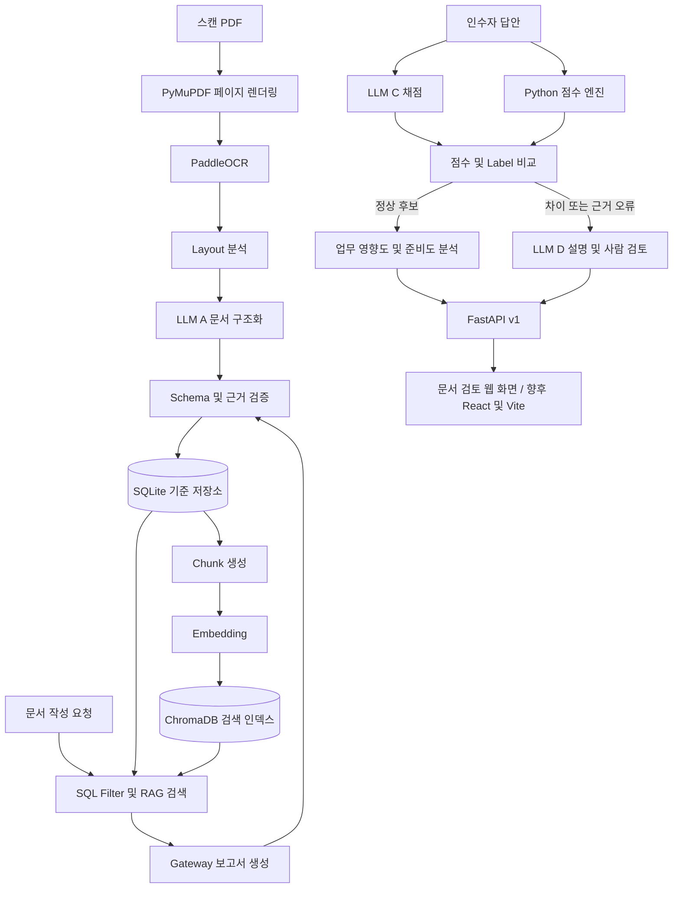

# 시스템 아키텍처

이 문서는 [개발 계획서](plan/develop.md)를 실제 코드 경계로 정리한 구현 아키텍처다.
외부 런타임보다 도메인 계약이 안쪽에 위치하는 Ports and Adapters 구조를 사용한다.

## 전체 흐름



## 계층과 의존 방향

```
API → Services → Domain
         ↓
       Ports ← Adapters
```

| 계층 | 책임 | 현재 상태 |
|---|---|---|
| `api` | 버전 API, 요청 검증, 응답 변환 | 문서·OCR·구조/Chunk·Layout·검토·검색·색인 정리·초안·점수 비교 |
| `services` | 여러 도메인 규칙과 포트를 유스케이스로 조합 | 등록·OCR·구조·Layout 평가·검색·색인 정리·초안 생성·점수 비교 |
| `domain` | 표준 JSON Schema, 점수 및 업무 분석 규칙 | 핵심 계약, Layout 규칙, 제어 문형 차단(`source_guard`) |
| `ports` | LLM·Repository·Vector Store 계약 | Protocol 구현 |
| `adapters` | SQLite·LLM·ChromaDB·OCR 실제 연동 | SQLite Repository들, PyMuPDF, PaddleOCR, Layout 분석기, E5 임베딩, Chroma, Ollama, Qwen(Transformers) |
| `web` | 문서 입력 및 원문 검토 | HTML/CSS/JS 단일 화면; OCR 검토·근거·Layout 검토·검색·초안 |

도메인과 서비스는 Ollama, ChromaDB, PaddleOCR의 응답 객체를 직접 참조하지 않는다.
외부 결과는 어댑터가 표준 Schema로 변환한다.

## 저장소 책임

SQLite는 문서와 OCR 원문, 계층 구조, Chunk 메타데이터, 근거 연결, 생성 실행 이력의 기준 저장소이다.
ChromaDB는 재구축할 수 있는 검색 인덱스이며 기준 데이터로 사용하지 않는다.

```
Local File Store
├─ 원본 PDF
└─ 렌더링한 페이지 이미지

SQLite
├─ Ingestion / Document / Page
├─ Section / DocumentBlock
├─ Chunk / ChunkSource
└─ GenerationRun

ChromaDB
└─ 실행별 Chunk ID + Embedding (원문·공개 여부는 SQLite에서 검증)
```

문서 변경 또는 OCR 재실행 시 새로운 `ingestion_id`를 만든다.
인덱스는 `pending → ready` 상태가 된 버전만 검색에 노출하고 실패한 인덱스는 SQLite와 원본 파일에서 재구축한다.

## LLM 역할과 Gateway

논리 역할은 최대 네 개지만 같은 로컬 모델을 역할별 설정으로 재사용할 수 있다.

| 역할 | Gateway 메서드 | 출력 |
|---|---|---|
| 문서 구조화 | `extract_document` | 구조화된 업무 및 문서 정보 |
| 문제 생성 | `generate_question` | 문제·정답·Rubric·근거 |
| 답안 평가 | `evaluate_answer` | 기준별 점수와 답안 근거 |
| 차이 설명 | `explain_difference` | 점수 차이 설명과 검토 정보 |

보고서 생성은 기존 Gateway의 `generate_report`를 사용하며 별도 다섯 번째 모델을 요구하지 않는다.
Provider 호출 전후의 모델 ID, Prompt·Schema 버전, 검색 근거 ID, 처리 시간과 결과 상태를 `generation_run`에 남긴다.

## 검증 경계

- LLM 출력은 Pydantic 검증 전까지 신뢰하지 않는다.
- 인수인계서의 모든 내용은 등록된 `evidence_id`를 참조해야 한다.
- LLM이 만든 SQL은 실행하지 않고 미리 정의된 Query만 매개변수화해 실행한다.
- 두 점수가 모두 있고 Label이 같으며 점수 차이가 5 이하인 경우만 자동 처리 후보로 둔다.
- 자동 처리 후보는 실제 인수인계 완료 승인이 아니며 담당자의 최종 판단을 대체하지 않는다.

## 단계별 구현 상태

| 단계 | 내용 | 상태 | 안내 |
|---|---|---|---|
| 1 | SQLite 문서 Repository, 등록 트랜잭션, 목록·상세 API | 완료 | [파이프라인 §1](pipeline.md#1-문서-등록) |
| 2 | PyMuPDF·PaddleOCR 어댑터, 작업 상태/재처리 | 완료 | [파이프라인 §2](pipeline.md#2-pdf-렌더링과-ocr) |
| 3 | 페이지 구조·Chunk·원문 근거, 규칙 기반 Layout, 페이지 검토 기록 | 완료(표 셀 복원·실제 정확도 미측정) | [파이프라인 §3~5](pipeline.md#3-문서-구조chunk원문-근거-페이지-순서-방식) |
| 4 | E5·ChromaDB 색인/검색, 이전 색인 정리 | 완료 | [검색과 초안 §1~2](search-and-draft.md) |
| 5 | 원문 발췌 초안: Qwen3-4B 직접 실행·Ollama Gateway, 제어 문형 차단 | 구현, 실제 문서 품질 미달 | [검색과 초안 §3](search-and-draft.md#3-로컬-모델-원문-발췌-초안) |
| 6 | 목차·내용 편집, PDF 출력 | 미착수 | [로드맵](roadmap.md) |
| 7 | 문제 생성·답안 평가(LLM C/D), 준비도·추천, React UI | 미착수(점수 비교 엔진만 구현) | [로드맵](roadmap.md) |
| 8 | 장애 주입·모델 교체·근거 추적 Golden Test | 미착수 | |

구조 버전은 `structure_run`과 `structure_section`으로 관리하며 기존 원문 Block을 덮어쓰지 않고 과거 근거를 보존한다.

## 코드 읽기 안내

처음에는 아래 순서로 읽으면 됩니다. 소스의 `[읽기 안내]`와 함수 내부 `#` 주석은
학습용 설명이며 읽은 뒤 삭제해도 실행 동작에는 영향이 없습니다. 기존 docstring은
일부 API 설명에도 사용되므로 필요에 따라 남겨 두세요.

### 1. 전체 구조

`main.py → api/routes → services → domain + ports → adapters`

- `main.py`: 앱을 만들고 라우터와 시작 작업을 등록합니다.
- `config.py`, `api/dependencies.py`: 환경 설정과 실제 구현 객체를 조립합니다.
- `api/routes`: HTTP 요청/응답과 상태 코드를 다룹니다.
- `services`: 등록·OCR·평가처럼 한 번의 작업 순서를 조정합니다.
- `domain`: 데이터 형식, 검증 조건, 점수 계산 같은 업무 규칙입니다.
- `ports`: 서비스가 외부 기술에 요구하는 메서드 계약입니다.
- `adapters`: SQLite·PyMuPDF·PaddleOCR로 그 계약을 구현합니다.

### 2. PDF 등록 따라 읽기

1. `api/routes/documents.py`의 `register_document`: 업로드 파일을 받습니다.
2. `services/documents.py`의 `register`: 임시 파일 복사, 크기/해시 계산을 합니다.
3. `adapters/pdf.py`: PDF를 실제로 열어 유효성과 페이지 수를 확인합니다.
4. `adapters/document_repository.py`: 중복 조회와 메타데이터 저장을 합니다.
5. `adapters/sqlite.py`의 `connect`: 성공 시 commit, 실패 시 rollback합니다.
6. 서비스의 `finally`: 임시 파일과 실패한 요청의 원본을 정리합니다.

`tests/test_documents.py`를 나란히 보면 각 분기가 어떤 상황에서 실행되는지 확인할 수 있습니다.

### 3. OCR 따라 읽기

1. `api/routes/ocr.py`: 요청을 받아 202와 작업 ID를 반환합니다.
2. `services/ocr.py`의 `enqueue`: 새 작업과 처리 버전을 DB에 만듭니다.
3. 응답 뒤 `BackgroundTasks`가 같은 서비스의 `run`을 호출합니다.
4. `adapters/ocr.py`: PDF 페이지를 PNG로 바꾸고 OCR 결과를 표준 좌표로 변환합니다.
5. `adapters/ocr_repository.py`: 페이지·텍스트·진행률을 저장합니다.
6. 전체 성공 시 `complete`가 문서의 현재 처리 버전을 바꿉니다.
7. 실패 시 `fail`은 새 작업만 실패로 기록하고 이전 성공 결과를 유지합니다.

원본 파일 ID인 `document_id`, 처리 버전인 `ingestion_id`, 진행 상태 조회용 `job_id`는
서로 역할이 다릅니다. `domain/ocr.py`의 주석에서 좌표와 상태 표현을 확인하세요.

### 4. 평가 계산 따라 읽기

`api/routes/evaluations.py → services/evaluation.py → domain/scoring.py`

현재는 두 경로에서 전달받은 기준별 점수를 환산하고 비교합니다. LLM 자동 채점은 아직
연결되지 않았습니다. `None`은 0점이 아니라 계산 불가, `accepted_candidate`는 최종 승인이
아니라 자동 처리 후보입니다. `tests/test_scoring.py`의 작은 숫자 예제부터 읽으면 편합니다.

### 자주 나오는 문법

| 표현 | 이 프로젝트에서의 의미 |
|---|---|
| `Protocol` | 구현체가 제공해야 할 메서드 목록 |
| `BaseModel`, `Field` | 데이터 형식과 입력 제약 검증 |
| `Annotated[..., Depends(...)]` | FastAPI가 필요한 객체를 준비해 인자로 전달 |
| `with` | 파일/DB 연결을 정해진 범위에서 사용하고 정리 |
| `yield` | 연결을 with 본문에 전달하거나 페이지를 하나씩 생성 |
| `try/except/finally` | 처리 시도, 오류 대응, 성공 여부와 무관한 정리 |
| SQL의 `?` | 문자열 조립 대신 값을 안전하게 바인딩하는 자리 |
| `rowcount` | 조건부 UPDATE에 실제로 영향을 받은 행 수 |
| `@lru_cache` | 같은 인자의 객체 생성 결과 재사용 |
