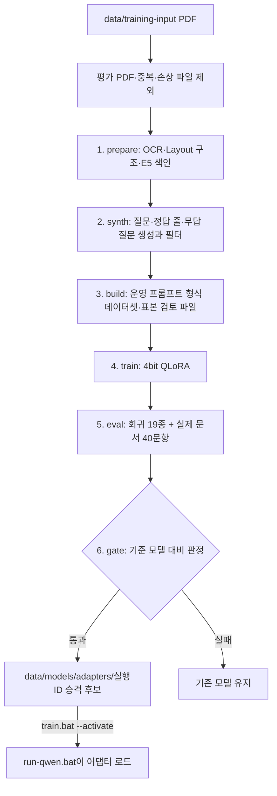

# 로컬 모델 학습

LoRA 자동 학습 시스템과 학습 결과.

## 목차

1. [로컬 모델 자동 학습 시스템](#로컬-모델-자동-학습-시스템)
2. [LoRA 학습 결과 — TR-20261016-000200 (2026-10-16)](#lora-학습-결과--tr-20261016-000200-2026-10-16)

---

## 로컬 모델 자동 학습 시스템

2026-10-13 작성. 정답 없는 업무 PDF로 Qwen3-4B의 LoRA 어댑터를 학습·평가·등록한다.
[개발 계획](plan/develop.md), [초안 생성](search-and-draft.md#로컬-모델-원문-발췌-초안),
[실제 문서 예비 평가 결과](evaluation.md#실제-문서-예비-평가-결과--2026-10-1213)를 기준으로 설계했다.

### 사용 방법

1. 학습용 업무 PDF를 다음 폴더에 넣는다. 하위 폴더도 된다. 정답이나 질문은 필요 없다.

   ```text
   C:\Github\Local_LLM_Handover-\data\training-input\
   ```

2. 프로젝트 폴더의 `train.bat`을 실행한다. OCR → 합성 질문 → 학습 → 평가 → 판정까지
   자동으로 진행한다. 중간에 끊겨도 다시 실행하면 이어서 진행한다.
3. 결과가 **게이트 통과**이면 안내된 명령으로 적용한다. 실패이면 기존 모델을 그대로 쓴다.

| 명령 | 동작 |
|---|---|
| `train.bat` | 새 PDF가 있으면 학습. 중단된 실행이 있으면 이어서 진행 |
| `train.bat --force` | 새 PDF가 없어도 다시 학습 |
| `train.bat --status` | 학습 실행 목록·판정·현재 적용된 어댑터 |
| `train.bat --activate TR-…` | 통과한 어댑터를 적용. `run-qwen.bat` 재시작 후 반영 |
| `train.bat --deactivate` | 어댑터 해제, 기반 모델만 사용 |
| `train.bat --schedule 02:00` | 매일 지정 시각에 자동 실행 (Windows 작업 스케줄러) |
| `train.bat --unschedule` | 자동 실행 해제 |

주의할 점:

- **평가용 8개 PDF와 같은 파일은 자동으로 제외한다.** 평가 문서로 학습하면 평가 결과를 믿을 수 없다.
- 학습 중에는 화면에서 초안 생성을 하지 않는다. 같은 GPU를 쓴다. GPU 여유 메모리가
  6GB 미만이면 단계를 시작하지 않고, 메모리를 비운 뒤 다시 실행하면 이어서 진행한다.
- 첫 실행은 OCR(쪽당 약 10초)과 **기준 모델의 실제 문서 평가 1회**(약 30분)가 추가된다.
  기준 평가는 프롬프트 버전이 바뀌기 전까지 재사용한다.
- 학습 시간 대략값(RTX 4070 Ti): 합성 질문 묶음당 5~10초, 학습 예제 3,000개 × 2 epoch에
  1~3시간, 회귀·실제 문서 평가 약 40분.
- 학습 예제가 50개 미만이면 중단한다. 대략 **50쪽 이상**의 업무 PDF를 권장한다.
- 자동 실행 로그: `data/training-runs/<실행 ID>/pipeline.log`

### 1. 무엇을 학습하는가

#### 1.1. 대상

기반 모델은 운영 경로의 **Qwen3-4B**(`data/models/Qwen3-4B`)로 고정한다. 기반 가중치는
바꾸지 않고 LoRA 어댑터 하나(`excerpt`)만 학습한다. 운영 Worker는 한 번 올린 모델로
다음 두 요청을 모두 처리하므로 어댑터도 두 작업을 함께 학습한다.

| 작업 | 입력 | 출력 |
|---|---|---|
| `select` 원문 선택 | 질문 + 별칭 ID Block 목록 | `{"items":[{"block_id","category"}]}` |
| `verify` 관련성 판정 | 질문 + 원문 1개 | `YES` / `NO` |

LLM A·B·C·D(구조화·문제 생성·채점·설명)는 같은 방식으로 나중에 붙인다. 채점(LLM C)은
[develop.md 3.8.2](plan/develop.md)의 2인 독립 채점 Human Score가 생기기 전에는 시작하지 않는다.

#### 1.2. 왜 이 작업부터인가

실제 문서 예비 평가에서 손실이 가장 큰 구간이 모델 단계다.

| 단계 | 정답 인용문 포함 |
|---|---:|
| OCR | 37 / 49 |
| 검색 상위 5개 | 21 / 49 |
| 모델 후보 | 12 / 49 |
| **최종 선택** | **2 / 49** |

후보에 있던 정답이 대부분 최종 선택에서 사라졌고(유답 32개 중 12개가 근거 없음),
DOC07-Q05에서는 질문 조건을 충족하지 않는 숫자를 골랐다.

#### 1.3. 학습으로 해결하지 않는 것

| 결함 | 담당 |
|---|---|
| 문장·표 행이 OCR 줄 단위로 잘림 | 문단/표 행 근거 묶음 구조 버전 ([next-steps](roadmap.md) 1순위) |
| 검색 누락 | 검색·Chunk·후보 예산 개선 |
| 숫자 OCR 오류 | 사람 교정 revision. 모델이 값을 추정해 고치지 않는다 |
| 120초 시간 초과 | 요청마다 모델을 올리는 Worker 구조와 입력 길이 |
| 지시문 주입 | `explicit-control-v1` 규칙 유지. 학습은 보안 경계가 아니다 |

### 2. 전체 흐름



각 단계는 별도 프로세스로 실행해 단계가 끝날 때 GPU 메모리를 회수한다. 완료 단계는
`stages.json`에 기록하고 재실행 시 건너뛴다. 같은 작업 폴더를 두 학습이 동시에 쓰지 않도록
`train.lock`을 사용한다.

```text
data/training-input/            사용자가 넣는 PDF
data/training-work/             여러 실행이 공유하는 준비 결과
├─ training.db, chroma/, pages/ 학습 문서의 OCR·구조·색인 (앱 DB와 분리)
├─ synthetic/                   문서별 합성 기록 캐시 (생성 규칙 버전별)
├─ eval-baseline-<프롬프트>/      기준 모델 실제 문서 평가 (최초 1회)
└─ state.json                   마지막 완료 실행과 입력 지문
data/training-runs/TR-…/
├─ documents.json, fingerprint.json, stages.json, pipeline.log
├─ dataset/  train.jsonl, val.jsonl, data-card.json, review-sample.md
├─ adapter/  LoRA 가중치, training-meta.json
├─ eval/     regression.json, real/ (실제 문서 평가 전체)
└─ gate.json
data/models/adapters/TR-…/      게이트 통과 어댑터, active.txt
```

### 3. 데이터

#### 3.1. 출처와 용도

| 출처 | 학습 | 평가 |
|---|:-:|:-:|
| `data/training-input`의 정답 없는 PDF → 합성 질문 | ✓ | 검증 손실만 |
| 실제 40문항 정답과 8개 평가 PDF | ✗ | ✓ 게이트 |
| Qwen 회귀 사례 19종 | ✗ | ✓ 게이트 |

40문항과 평가 PDF는 학습에 쓰지 않는다. 평가 PDF와 해시가 같은 입력은 자동 제외한다.
학습 PDF 안에서는 문서 단위로 검증 문서를 나눈다(3개 이상일 때 약 20%). 3개 미만이면
같은 문서 안에서 나누며 로그에 경고를 남긴다.

#### 3.2. 합성 질문 생성 (`synth`)

1. Layout 구조의 같은 Chunk 안에서 연속된 OCR 줄을 최대 12줄·700자 묶음으로 만든다.
   절반씩 겹쳐서 묶음 경계에 걸린 문장도 다른 묶음에서 온전히 보이게 한다.
   문서당 묶음 수는 쪽수 기준 20~80개다.
2. 기반 Qwen3-4B(4bit, 어댑터 없음)가 줄 번호가 붙은 묶음을 보고 질문, 정답 줄 번호,
   범주, **무답 질문**(같은 주제지만 원문에 없는 연도·기관·수량 등을 묻는 질문)을 만든다.
   정답 줄은 여러 줄로 나뉜 절차를 빠짐없이 포함하도록 지시한다.
3. 필터: JSON·줄 번호·범주 오류, 원문 15자 이상을 그대로 복사한 질문, 정답 줄이 대부분
   제목 조각이거나 묶음의 70% 이상(또는 7줄 이상)을 차지하는 경우를 버린다.
   서식 PDF에서 제목 줄을 모두 정답으로 고르는 사례가 실제로 나와 추가한 규칙이다.
4. 무답 질문은 기반 모델의 관련성 판정이 정답 줄에 대해 `NO`일 때만 사용한다.
5. 후보 목록은 운영과 같은 함수로 만든다. E5 검색 상위 5개 → `eligible_sources`
   (60 Block/12,000자 제한) → `screen_sources`(제어 문형 차단). 정답이 후보 밖이면
   선택 예제를 만들지 않는다(검색 실패를 모델 탓으로 학습하지 않는다).

#### 3.3. 학습 예제 (`build`)

| 예제 | 라벨 |
|---|---|
| 질문 + 후보 | 정답 줄(같은 문장의 반복 Block 포함)을 선택 |
| 무답 질문 + 그 후보 | 빈 선택 |
| 질문 + 정답 줄 하나 | YES (10자 미만 조각은 제외) |
| 무답 질문 + 정답 줄 하나 | NO |
| 질문 + 다른 문서의 줄 | NO |

작업·라벨 묶음별로 고르게 최대 3,000개를 뽑는다. 입력 메시지는 운영 Worker의
`selection_messages` / `relevance_messages`를 그대로 호출해 만든다. 프롬프트를 복제하지 않는다.
`review-sample.md`에 합성 기록 30개를 원문과 함께 남긴다. 합성 라벨에는 잡음이 있으므로
사람이 이 표본을 보고 오류가 많으면 생성 규칙(`GENERATOR_VERSION`)을 고친다.

### 4. 학습 (`train`)

| 항목 | 기본값 | 옵션 |
|---|---|---|
| 방식 | 4bit NF4 기반 + bf16 LoRA, gradient checkpointing | |
| LoRA | r=16, alpha=32, dropout 0.05, 모든 선형 층 | `--rank` |
| 학습률 | 1e-4, cosine, warmup 3% | `--learning-rate` |
| 배치 | 1 × gradient accumulation 16 | `--grad-accum` |
| 최대 길이 | 6,144토큰, 초과 예제 제외 | `--max-tokens` |
| Epoch | 2, 검증 손실이 가장 낮은 epoch 저장 | `--epochs` |

- 채팅 템플릿은 운영과 같은 `enable_thinking=False`, 손실은 답 토큰에만 계산한다.
- 답 위치의 logits만 계산한다(`logits_to_keep`). 전체 어휘 logits는 12GB에 들어가지 않는다.
- 메모리 부족 예제는 건너뛰고 수를 `training-meta.json`에 기록한다.
- `training-meta.json`의 `prompt_version`이 운영 Gateway와 다르면 어댑터를 로드하지 않는다.

### 5. 평가와 게이트 (`eval`, `gate`)

같은 평가를 기준 모델과 후보 어댑터에 실행한다. 기존 도구에 `--adapter` 옵션을 추가했다.

1. `scripts/validate_local_qwen.py --all --adapter …` (회귀 19종)
2. `scripts/evaluate_real_documents.py --adapter …` (40문항). 기존 평가 폴더
   `data/real-evaluation-20261012`의 OCR·색인을 복사해 605쪽 OCR을 다시 하지 않는다.

게이트 항목은 하나라도 실패하면 탈락이다.

| 항목 | 조건 |
|---|---|
| 회귀 19종 | 모두 통과 |
| 실제 문서 문항 | 기준과 같은 수를 모두 실행 |
| `false_answer` · `execution_error` · `missed_answer` | 기준 이하 |
| `selected_quote_exact` | 기준 이상 |
| 정답 페이지 밖 발췌 | 발췌가 모두 정답 페이지 밖인 유답 문항 수가 기준 이하 (2026-10-18 추가) |
| 개선 | `missed_answer` 감소 또는 `selected_quote_exact` 증가 |
| 처리 시간 p95 | 기준의 1.2배 이하 |

평가 문항이 40개뿐이라 1~2문항 차이는 잡음일 수 있다. 따라서 통과해도 자동 적용하지 않고
**승격 후보**로만 등록한다. 사람이 `gate.json`과 `eval/real/report.html`을 확인한 뒤
`--activate`로 적용한다. 활성화·해제는 `active.txt` 한 줄만 바꾸며 파일을 지우지 않는다.
생성 이력의 모델 이름은 `Qwen3-4B+TR-…`로 남아 어떤 어댑터로 만든 초안인지 구분된다.

기준 평가와 후보 평가는 실행 시점의 GPU 여유 메모리가 다르면 처리 시간·시간 초과가 달라질 수
있다. 두 평가 모두 다른 GPU 프로그램을 끈 상태에서 실행하는 것이 공정하다.

### 6. 코드 위치

| 파일 | 역할 |
|---|---|
| `train.bat` | 패키지 확인·설치, 파이프라인 실행, 작업 스케줄러 등록 |
| `scripts/train_pipeline.py` | 단계 실행·재개·잠금·상태·활성화 명령 |
| `src/handover_ai/training/data.py` | 묶음·생성 결과 검사·학습 예제·분할 (순수 함수) |
| `src/handover_ai/training/model.py` | 4bit 생성기, QLoRA 학습 |
| `src/handover_ai/training/gate.py` | 게이트 판정 |
| `adapters/qwen_worker.py` | `selection_messages` 분리, 어댑터 로드 |
| `adapters/local_qwen.py` | 어댑터 경로·프롬프트 버전 검증 |
| `services/drafts.py` | 후보 규칙 `eligible_sources` 분리 |
| `run-qwen.bat` | `active.txt`가 있으면 `LLM_ADAPTER_PATH` 설정 |

### 7. 아직 하지 않은 것

- 초안 화면의 Block별 사람 피드백(유지·제외·추가·분류 변경) 수집과 학습 반영.
  피드백은 합성 데이터보다 정확한 라벨이므로 다음 확장 대상이다.
- 문단/표 행 근거 묶음 구조 버전. 이 구조가 생기면 학습 단위도 바뀌므로 다시 학습한다.
- 정답 위치(쪽·인용문·좌표) 기반 저장. 지금은 합성 기록이 Layout 구조의 Block ID를 쓴다.
- LLM A·B·C·D 역할 어댑터.

---

## LoRA 학습 결과 — TR-20261016-000200 (2026-10-16)

업무 매뉴얼 PDF 13개(2,027쪽)에서 합성 학습 데이터를 만들고, Qwen3-4B에 LoRA 어댑터를
학습했다. 같은 실제 문서 40문항으로 기준 모델과 비교하는 **게이트 8개 항목을 모두 통과**했고,
어댑터는 승격 후보로 등록됐다. **아직 적용(activate)하지 않았다.**

| 항목 | 기준 모델 | 어댑터 | 변화 |
|---|---:|---:|---|
| 유답인데 근거 없음으로 처리 | 11 | **3** | −8 |
| 최종 선택 정답 인용문 (49개 중) | 2 | **6** | +4 |
| 무답 질문 오선택 | 1 | **0** | −1 |
| 시간 초과·모델 오류 | 1 | **0** | −1 |
| 문항 처리 시간 p95 | 25.4초 | **18.1초** | −29% |

이 결과는 운영 품질 합격 판정이 아니다. 정답 파일은 사람 최종 검증 전 초안이고,
"발췌 생성"은 의미상 정답이라는 뜻이 아니다. 아래 [남은 확인 사항](#남은-확인-사항)을 함께 읽는다.

### 결과와 재현 자료

모두 Git 제외 경로(`data/`)에 있으며 이 PC에서만 열린다.

- [게이트 판정](../data/training-runs/TR-20261016-000200/gate.json)
- [실행 로그](../data/training-runs/TR-20261016-000200/pipeline.log)
- [어댑터 학습 기록](../data/training-runs/TR-20261016-000200/adapter/training-meta.json)
- [합성 데이터 카드](../data/training-runs/TR-20261016-000200/dataset/data-card.json) ·
  [표본 검토지](../data/training-runs/TR-20261016-000200/dataset/review-sample.md)
- 어댑터 실제 문서 평가: [HTML 보고서](../data/training-runs/TR-20261016-000200/eval/real/report.html) ·
  [요약](../data/training-runs/TR-20261016-000200/eval/real/summary.md) ·
  [초안 내용 검토 목록](../data/training-runs/TR-20261016-000200/eval/real/review-queue.md)
- [기준 모델 실제 문서 평가 요약](../data/training-work/eval-baseline-qwen-excerpt-v9-source-guard/summary.md)
- 승격 후보 어댑터: `data/models/adapters/TR-20261016-000200/`
- 파이프라인 구조와 게이트 규칙: [training-pipeline.md](#로컬-모델-자동-학습-시스템)

### 실행 환경과 소요 시간

| 항목 | 값 |
|---|---|
| 기준 모델 | Qwen3-4B (`data/models/Qwen3-4B`) |
| 프롬프트 버전 | `qwen-excerpt-v9-source-guard` |
| GPU | NVIDIA GeForce RTX 4070 Ti |
| 라이브러리 | torch 2.13.0+cu126, transformers 5.18.0, accelerate 1.15.0 |

| 단계 | 시작 | 소요 | 내용 |
|---|---|---:|---|
| prepare | 00:02 | 7시간 18분 | PDF 13개 OCR·레이아웃 |
| synth | 07:20 | 1시간 11분 | 원문 묶음에서 질문·정답 합성 |
| build | 08:30 | 2초 | 학습/검증 세트 구성 |
| train | 08:30 | 2시간 16분 | LoRA 2 epoch |
| eval | 10:47 | 24분 | 회귀 19종 + 기준·어댑터 실제 문서 평가 |
| gate | 11:10 | 2초 | 판정 |

전체 약 11시간 9분. OCR이 전체 시간의 2/3를 차지한다.

### 학습 데이터

입력 PDF 13개, 2,027쪽. 원문 묶음 931개에서 질문 384개를 합성해 저장했다.

| 제외 사유 | 건수 |
|---|---:|
| 질문이 원문을 그대로 베낌 (`question_copies_source`) | 246 |
| 정답이 대부분 제목 줄 (`answer_mostly_headings`) | 167 |
| 정답 범위가 너무 넓음 (`answer_too_broad`) | 133 |
| 무답 질문인데 원문으로 답할 수 있음 (`negative_answerable`) | 85 |
| 범주 오류 (`bad_category`) | 1 |

문서 단위로 나눠 검증 문서 3개(사업계획·수지예산 작성지침, 2026 정기통계품질진단 매뉴얼,
채용절차 공정화 매뉴얼)는 학습에 쓰지 않았다.

| 과제/유형 | 학습 | 검증 |
|---|---:|---:|
| verify / positive | 634 | 206 |
| verify / negative | 758 | 254 |
| select / positive | 163 | 61 |
| select / negative | 220 | 79 |
| 합계 | 1,775 | 600 |

길이 초과·메모리 부족으로 건너뛴 예제는 없다.

### 학습 설정과 경과

epochs 2 · LoRA rank 16 · learning rate 1e-4 · gradient accumulation 16 ·
max tokens 6144 · seed 20261013

| epoch | 학습 손실 | 검증 손실 | verify 정확 일치 | select 정확 일치 | 소요 |
|---:|---:|---:|---:|---:|---:|
| **1 (저장됨)** | 0.152 | **0.0897** | 95.2% | **59.3%** | 59분 |
| 2 | 0.029 | 0.0940 | 95.7% | 57.1% | 77분 |

어댑터는 검증 손실이 가장 낮은 epoch를 저장한다(`src/handover_ai/training/model.py`).
그래서 **배포 후보는 epoch 1**이다. epoch 2는 학습 손실이 1/5로 떨어졌지만 검증 손실과 select
일치율이 나빠졌다. 합성 데이터에 과적합하기 시작했다는 신호이므로, 같은 데이터 규모라면
다음 실행은 1 epoch로 충분하다.

### 평가와 게이트

#### 기존 Qwen 회귀 사례

어댑터를 적용한 상태에서 19종 전체 통과.

#### 실제 문서 40문항 (PDF 8개, 605쪽, 유답 32 · 무답 8)

| 실행 결과 | 기준 모델 | 어댑터 |
|---|---:|---:|
| 발췌 생성 (`answer_generated`) | 20 | 29 |
| 무답 정상 거절 (`correct_abstention`) | 7 | 8 |
| 유답인데 근거 없음 (`missed_answer`) | 11 | 3 |
| 무답인데 원문 선택 (`false_answer`) | 1 | 0 |
| 실행 오류 (`execution_error`) | 1 | 0 |

| 정답 인용문 포함 단계 (49개 중) | 기준 모델 | 어댑터 |
|---|---:|---:|
| OCR | 37 | 37 |
| 검색 상위 5개 | 21 | 21 |
| 모델 후보 | 12 | 12 |
| **최종 선택** | **2** | **6** |

OCR·검색은 바뀌지 않았으므로 앞의 세 단계는 같다. 어댑터가 바꾼 것은 마지막 선택 단계다.
정답의 모든 근거 페이지를 검색한 유답 문항은 두 실행 모두 27/32개다.

| 처리 시간 | 기준 모델 | 어댑터 |
|---|---:|---:|
| 평균 | 14.9초 | 15.5초 |
| 중앙값 | 12.9초 | 15.2초 |
| p95 | 25.4초 | 18.1초 |
| 최대 | 65.0초 (시간 초과) | 24.7초 |

평균과 중앙값은 조금 늘었다. 기준 모델이 근거 없음으로 빨리 끝내던 문항에서 이제 발췌를
생성하기 때문이다. 반면 꼬리 지연과 시간 초과는 사라졌다.

#### 결과가 바뀐 문항 (10개)

| 문항 | 기준 모델 | 어댑터 | 근거 페이지 검색 |
|---|---|---|---|
| DOC01-Q04 | 실행 오류 (`invalid_model_output`) | 발췌 생성 | ✓ |
| DOC02-Q02 | 근거 없음 | 발췌 생성 | ✓ |
| DOC02-Q03 | 근거 없음 | 발췌 생성 | **✗** |
| DOC03-Q03 | 근거 없음 | 발췌 생성 | **✗** |
| DOC05-Q03 | 근거 없음 | 발췌 생성 | ✓ |
| DOC05-Q04 | 근거 없음 | 발췌 생성 | ✓ |
| DOC07-Q02 | 근거 없음 | 발췌 생성 | ✓ |
| DOC07-Q04 | 근거 없음 | 발췌 생성 | ✓ |
| DOC07-Q05 (무답) | 원문 오선택 | 정상 거절 | – |
| DOC08-Q02 | 근거 없음 | 발췌 생성 | ✓ |

나빠진 문항은 없다. 아직 근거 없음으로 남은 유답 문항은 DOC02-Q04, DOC04-Q02, DOC07-Q01이다.

#### 게이트 판정

| 규칙 | 기준 → 후보 | 결과 |
|---|---|---|
| 기존 Qwen 회귀 사례 전체 통과 | – | 통과 |
| 실제 문서 문항 전체 실행 | 40 → 40 | 통과 |
| 무답 질문 오선택 증가 금지 | 1 → 0 | 통과 |
| 시간 초과·모델 오류 증가 금지 | 1 → 0 | 통과 |
| 유답 질문 근거 없음 처리 증가 금지 | 11 → 3 | 통과 |
| 최종 선택 정답 인용문 감소 금지 | 2 → 6 | 통과 |
| 근거 없음 감소 또는 정답 인용문 증가 중 하나 이상 | – | 통과 |
| 문항 처리 시간 p95 ≤ 기준 × 1.2 | 25.4 → 18.1초 | 통과 |

2026-10-18에 추가한 "정답 페이지 밖에서만 발췌한 유답 질문 증가 금지" 항목으로 같은 결과를
다시 판정하면 6 → 9로 **탈락**이다. 기존 `gate.json`은 당시 판정 기록으로 두고 덮어쓰지 않았다.
늘어난 문항은 DOC02-Q03, DOC03-Q03, DOC07-Q04, DOC08-Q02 등이다(DOC01-Q01은 정답 페이지로 이동).

### 남은 확인 사항

1. **새로 생성된 발췌의 의미 검토.** 근거 없음에서 발췌 생성으로 바뀐 8문항이 실제 정답인지
   [초안 내용 검토 목록](../data/training-runs/TR-20261016-000200/eval/real/review-queue.md)에서
   확인한다. 특히 DOC02-Q03, DOC03-Q03은 정답 근거 페이지를 검색하지 못했는데도 발췌를
   만들었다. 다른 페이지의 비슷한 문장을 고른 것일 수 있다.
2. **합성 데이터 표본 검토.** [review-sample.md](../data/training-runs/TR-20261016-000200/dataset/review-sample.md)로
   합성 라벨 오류율을 기록한다. 표본에는 세로로 쪼개진 OCR 줄, 쪽 번호만 있는 줄 같은
   잡음이 보인다.
3. **최종 선택 6/49는 여전히 낮다.** 검색 상위 5개에 정답 인용문이 21개 들어 있으므로
   선택 단계의 개선 여지가 남아 있다. 검색 단계(37 → 21)의 손실도 크다.
4. **평가 세트 크기.** 40문항 중 10문항이 바뀐 결과라 문항 하나의 무게가 크다. 실제 문서
   평가 문항을 늘린 뒤 다시 비교하는 것이 좋다.

### 적용과 되돌리기

```bat
train.bat --activate TR-20261016-000200   rem run-qwen.bat에서 어댑터 사용
train.bat --status                        rem 실행 목록과 현재 적용 어댑터
train.bat --deactivate                    rem 기준 모델로 되돌림
```

권장 순서: 남은 확인 사항 1을 먼저 검토한 뒤 적용한다. 다음 학습은
`--force` 없이도 새 PDF가 `data/training-input/`에 추가되면 실행된다. 기본값은 2 epoch이므로
`train.bat --epochs 1`로 1 epoch를 지정하는 것을 권장한다.
